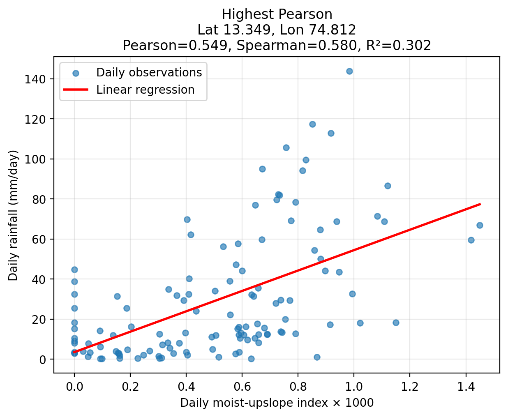
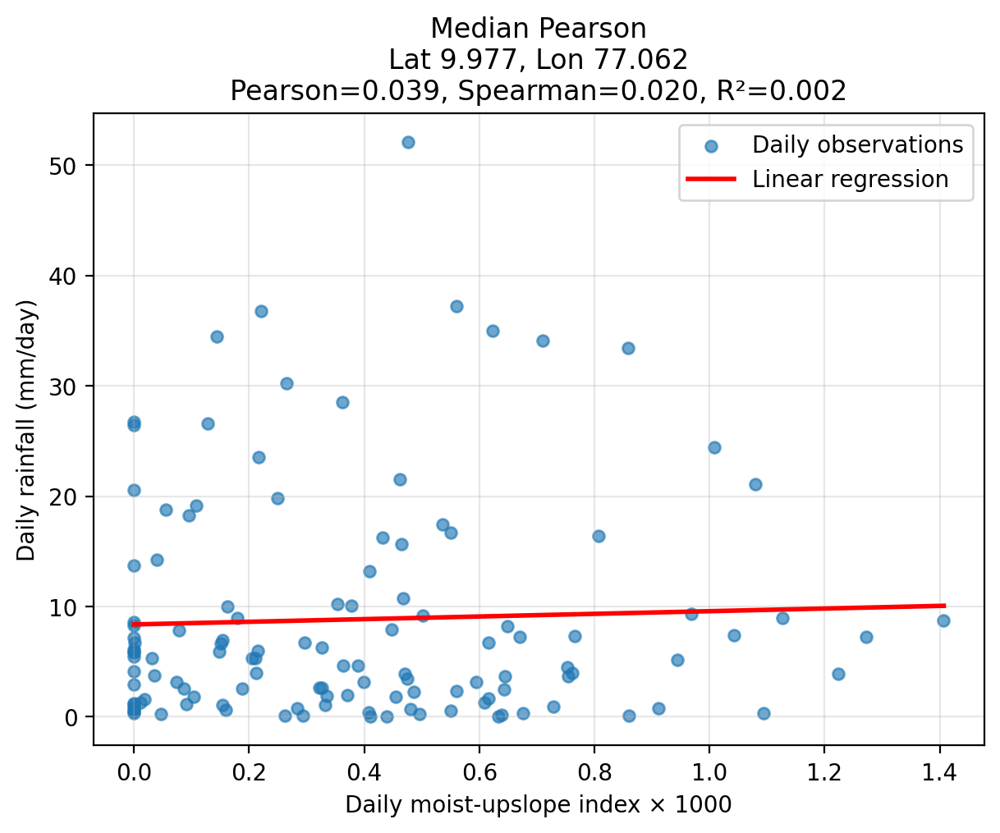
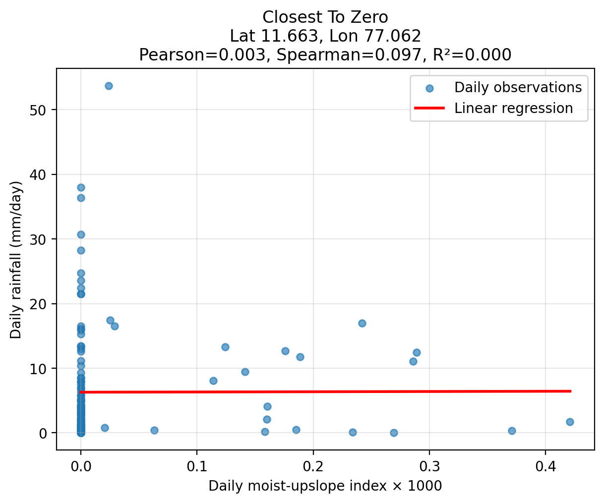

# Daily Grid-Cell Scatterplot Analysis — JJAS 2020

## 1. Objective

This analysis investigates the relationship between daily moisture-weighted orographic forcing and GPM IMERG precipitation during the southwest monsoon season (June–September 2020) over Kerala and the Western Ghats.

Pearson correlation, Spearman correlation and ordinary least-squares linear regression were calculated independently at each valid land grid cell.

Three representative scatterplots are presented to illustrate differences in the strength of the daily forcing–rainfall relationship.

## 2. Data and methodology

**Study period:** 1 June–30 September 2020 (122 days).

**Spatial domain:** 72–79°E, 7–14°N.

**Analysis grid:** ERA5-aligned 25 × 25 grid, containing 225 selected land cells.

**Datasets:**
- ERA5 700-hPa horizontal winds (`u`, `v`).
- ERA5 700-hPa specific humidity (`q`).
- SRTM terrain elevation gradients.
- GPM IMERG Final Run daily precipitation.

The terrain-related vertical-motion proxy is defined as:

`w_oro = u × dh/dx + v × dh/dy`

The moisture-weighted positive upslope index is:

`M = q × max(w_oro, 0)`

This index is a simplified diagnostic, not measured vertical velocity or vertically integrated moisture transport.

For each grid cell, daily values were compared using:

- **X-axis:** Daily moist-upslope index multiplied by 1,000.
- **Y-axis:** Daily GPM rainfall (mm/day).
- **Blue points:** Individual daily observations.
- **Red line:** Ordinary least-squares linear regression.

Pearson measures linear association, while Spearman measures monotonic rank association. R² quantifies the proportion of observed daily rainfall variance accounted for by the fitted linear relationship within the sample.

## 3. Representative scatterplot results

| Selected grid cell | Pearson | Spearman | R² |
|---|---:|---:|---:|
| Highest Pearson (13.349°N, 74.812°E) | 0.549 | 0.580 | 0.302 |
| Median correlation (9.98°N, 77.06°E) | ~0.04 | ~0.02 | ~0.002 |
| Closest to zero (11.663°N, 77.062°E) | 0.003 | 0.097 | ~0.000 |

### A. Highest Pearson correlation

The selected cell shows a moderate positive daily linear association between moist-upslope forcing and rainfall.

The upward-sloping regression line indicates that higher forcing generally corresponds to higher fitted rainfall. However, considerable scatter remains, including substantial differences in rainfall at similar forcing values.

The regression accounts for approximately 30.2% of the observed daily rainfall variance at this location.

### B. Median correlation

This cell has a weak daily association, with Pearson correlation close to 0.04.

The nearly horizontal regression line indicates that changes in the moist-upslope index correspond to very little systematic change in fitted rainfall.

The scatterplot also demonstrates that rainfall can occur on days with zero calculated positive moist-upslope forcing.

### C. Pearson correlation closest to zero

This cell shows essentially no linear association between the two daily variables (Pearson = 0.003).

The scatterplot contains a concentration of observations at zero moist-upslope forcing, with a wide range of rainfall amounts.

The nearly horizontal regression line and R² close to zero indicate that this one-variable regression accounts for almost none of the observed daily rainfall variation at this location.

## 4. Comparison with the earlier seasonal spatial analysis

The previous analysis compared seasonal-mean moist-upslope forcing with accumulated JJAS rainfall across 225 land cells.

Its results were:

- Pearson correlation: **0.6637**
- Spearman correlation: **0.7262**
- Regression R²: **0.4406**

For the separate daily grid-cell analysis, the spatial summaries were:

| Statistic | Mean across valid cells | Median across valid cells |
|---|---:|---:|
| Pearson | 0.0975 | 0.0391 |
| Spearman | 0.1241 | 0.0739 |
| R² | 0.0461 | 0.0070 |

These results suggest that the seasonal spatial association is stronger than the typical same-day association at an individual land cell.

However, the two approaches answer different scientific questions. The earlier analysis describes geographical differences in seasonal rainfall, whereas the new analysis describes daily rainfall variations at individual locations. The mean of individual grid-cell correlations is not equivalent to a pooled correlation.

## 5. Scientific interpretation and limitations

The results are consistent with moisture-weighted orographic forcing being associated with the geographical distribution of monsoon rainfall, while daily rainfall fluctuations depend on additional atmospheric processes.

Important limitations include:

- Orographic forcing is approximated using 700-hPa winds and coarse-grid terrain gradients.
- Daily averages may conceal shorter-lived rainfall and uplift events.
- Negative orographic forcing is set to zero in the moist-upslope index.
- Rainfall can occur even when the calculated positive forcing index equals zero.
- Daily observations may be temporally autocorrelated.
- The analysis covers only one monsoon season.
- Correlation and regression do not establish causation.
- R² values are in-sample statistics, not independently validated forecasting skill.

## 6. Conclusion

The three scatterplots demonstrate substantial spatial variability in the daily relationship between moist-upslope forcing and GPM rainfall.

The strongest selected correlation indicates a moderate positive daily association, whereas the median and near-zero-correlation cells show weak or negligible linear relationships.

Together with the earlier seasonal spatial analysis, these findings suggest that moisture-weighted orographic forcing is more strongly associated with geographical patterns of seasonal precipitation than with typical day-to-day rainfall variability at individual grid cells during JJAS 2020.
